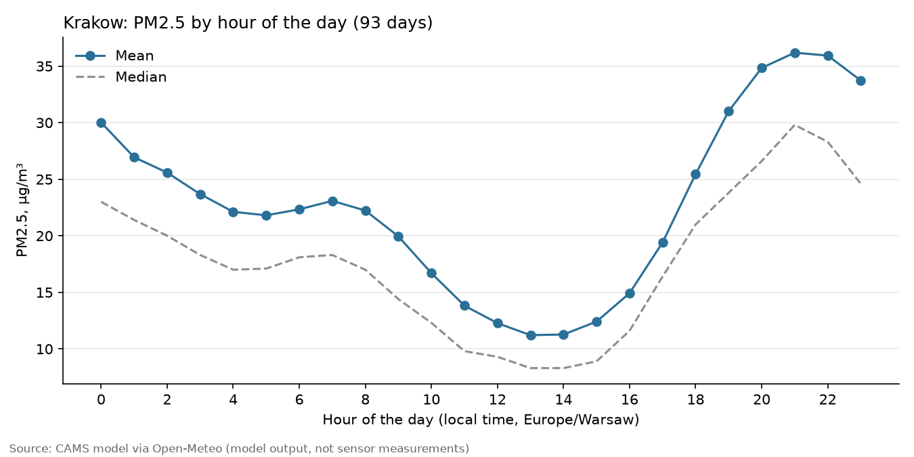

# Krakow Air Quality Tracker

Work in progress (started November 2026). A Python project that collects air quality and weather data for Krakow, stores it in a SQL database, analyses patterns (time of day, season, weather) and shows the results in a dashboard.

**Tools:** Python (requests, pandas, matplotlib, Streamlit, scikit-learn), SQL (SQLite), pytest

See [PLAN.md](PLAN.md) for the 30-day plan. Findings will be added as the project grows.

## Data

Source: [Open-Meteo Air Quality API](https://open-meteo.com/en/docs/air-quality-api).

- **What the numbers are:** model output from the CAMS European air quality forecast
  (Copernicus), not measurements from sensors on the ground. Resolution is about 11 km,
  hourly.
- **Pollutants:** PM10 and PM2.5, in μg/m³.
- **Location:** Krakow (latitude 50.0647, longitude 19.9450).
- **Time zone:** Europe/Warsaw.
- **Limit of one request:** the API returns up to 92 past days (`past_days`).

Attribution: CAMS European air quality forecasts, ENSEMBLE data, via Open-Meteo.
The API is free for non-commercial use; this is a portfolio project.

## Findings so far

**PM2.5 by hour of the day** (93 days, 21 August to 21 November 2026, hourly model values):

- The lowest average is at 13:00 (11.2 μg/m³) and the highest at 21:00 (36.2 μg/m³), more than three times higher.
- In the evening the mean is clearly above the median (21:00: mean 36.2, median 29.8), so a few very polluted days pull the average up.
- Limits: this is model output (not sensor measurements), covers only late summer and autumn, and says nothing about winter yet. Explanations such as heating or traffic are not tested here.



## Sources of the thresholds

Thresholds are for 24-hour means in μg/m³. Checked on 25 November 2026.

| Pollutant | WHO guideline 2021 | EU limit today (Directive 2008/50/EC) | EU limit from 2030 (Directive (EU) 2024/2881) |
|---|---|---|---|
| PM2.5 | 15 | none for 24 h | 25 (max. 18 days per year) |
| PM10 | 45 | 50 (max. 35 days per year) | 45 (max. 18 days per year) |

- WHO values: WHO Global Air Quality Guidelines 2021, as listed by [DieselNet](https://dieselnet.com/news/2021/09who.php); also [COMEAP statement](https://www.gov.uk/government/publications/comeap-statement-response-to-who-air-quality-guidelines-2021/comeap-statement-response-to-publication-of-the-world-health-organization-air-quality-guidelines-2021) (annual values).
- EU values: [EEA Air quality status report 2025, benchmark against Directive (EU) 2024/2881](https://www.eea.europa.eu/en/analysis/publications/air-quality-status-report-2025/benchmark-analysis-against-the-standards-in-the-revised-directive-eu-2024-2881); the directive: [EUR-Lex](https://eur-lex.europa.eu/eli/dir/2024/2881/oj).
- Annual limits are not compared, because the data covers only a few months.

## How to run

```
python3 -m venv .venv && source .venv/bin/activate
pip3 install -r requirements.txt
python3 src/update.py       # download only the missing days (air quality + weather), save to SQLite
python3 -m pytest           # run the tests
```

`update.py` looks at the newest hour in each table and downloads only the days that are missing
(7 days on the first run, at most 92). The log is also written to `logs/update.log`.
Requests are repeated up to 3 times if the network or the server has a short problem.

The steps can also be run one by one:

```
python3 src/extract.py --past-days 30   # raw JSON to data/raw/
python3 src/transform.py                # clean the data and print a summary
python3 src/load.py                     # load the raw files into data/air_quality.db
python3 src/weather.py --past-days 11   # weather into the second table
```

## Database

SQLite file `data/air_quality.db` (not stored in the repository, created on the first run):

| Table | Columns | Primary key |
|---|---|---|
| `air_quality` | time, pollutant, value, unit, loaded_at | (time, pollutant) |
| `weather` | time, variable, value, unit, loaded_at | (time, variable) |

Loading the same hour twice replaces the row, so repeated runs never create duplicates.

`python3 src/backfill.py` loads the maximum history (92 past days). In my run, air quality starts on
21 August 2026 and weather on 10 September 2026, so the two tables overlap only from 10 September.
